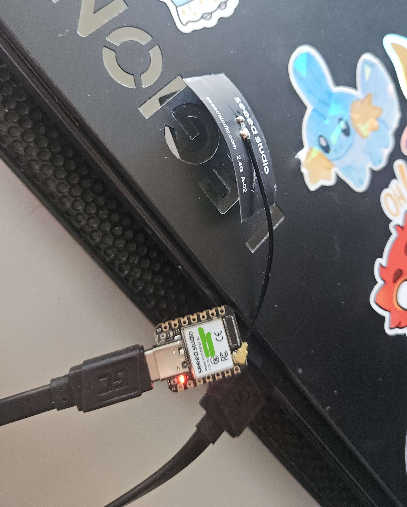

My laptop is where I run the heavy stuff: it has the GPU. I don't want it running all day for the odd job, so I let it sleep when idle and planned to wake it from my desktop when I need it. Wake-on-LAN exists for exactly this. On this laptop it doesn't work, so I built a tiny USB "keyboard" that wakes it over Wi-Fi instead.

## Wake-on-LAN: a dead end

Wake-on-LAN wakes a sleeping PC when its network card sees a "magic packet", a broadcast that repeats the card's MAC address. I tried it on both the Wi-Fi and the Ethernet card:

| | Wi-Fi | Ethernet |
|---|---|---|
| Windows wake settings | magic packet on | magic packet on, energy saving off |
| Armed for wake (`powercfg /devicequery wake_armed`) | yes | yes |
| Magic packets while asleep | no wake | no wake |
| Answers ARP while asleep | no | no |

Everything Windows lets you set was set, and the cards still went dark the moment the laptop slept. The laptop is a Lenovo Legion Pro 5 16ARX8, and its BIOS setup shows only "PXE Boot to LAN". I unpacked the latest BIOS update: its setup strings include "Wake On LAN" and "Enable Wlan Power In S3 And S4", so the options exist in Lenovo's shared code but are hidden on this model. Setting hidden BIOS variables by hand can leave a laptop that doesn't boot, so I stopped there.

## USB stays awake

One setting that *is* visible is "Always On USB": the USB ports keep their power while the laptop sleeps. And Windows lets USB keyboards wake the PC by default. USB has a feature for this, remote wakeup: while the host has the bus suspended, a device can signal "wake up", if the host allowed it to, and the host resumes.

So the plan: a small board that the laptop sees as a keyboard, that sits on Wi-Fi, and that sends a remote wakeup when my desktop asks it to over HTTP.

The board has to be able to act as a USB device, which rules out most cheap ESP32s: the C3, C5 and C6 only have a fixed USB serial port. The S2 and S3 have a real USB controller. I got a [Seeed XIAO ESP32-S3](https://wiki.seeedstudio.com/xiao_esp32s3_getting_started/) for €16. It has no antenna on the board, only a tiny connector for the one in the box, which clicks on.



## The firmware

I used [ESP-IDF](https://docs.espressif.com/projects/esp-idf/en/stable/esp32s3/), Espressif's own framework, in C, with its TinyUSB component, [`esp_tinyusb`](https://components.espressif.com/components/espressif/esp_tinyusb). ESP-IDF's HID example already does the hard part; the firmware is about 300 lines.

The USB side is a keyboard that tells the host it can wake it. That is one flag in the configuration descriptor, the block a USB device sends the host when it is plugged in:

```c
static const uint8_t configuration_descriptor[] = {
    TUD_CONFIG_DESCRIPTOR(1, 1, 0, TUD_CONFIG_DESC_LEN + TUD_HID_DESC_LEN,
                          TUSB_DESC_CONFIG_ATT_REMOTE_WAKEUP, 100),
    TUD_HID_DESCRIPTOR(0, 4, HID_ITF_PROTOCOL_NONE, sizeof(report_descriptor), 0x81, 16, 10),
};
```

When the laptop sleeps, it suspends the bus and says whether this device may wake it:

```c
static void on_usb_event(tinyusb_event_t *event, void *arg)
{
    if (event->id == TINYUSB_EVENT_SUSPENDED) {
        remote_wakeup_enabled = event->suspended.remote_wakeup;
    } else if (event->id == TINYUSB_EVENT_RESUMED) {
        remote_wakeup_enabled = false;
    }
}
```

The board joins the Wi-Fi as `esp32-usb-waker`. I started with mDNS for the name, but after a week my desktop stopped resolving it, and the router's DNS already knew the board by the hostname it sends with its DHCP request. Every endpoint takes a token. `GET /status` says whether the bus is awake, suspended or unmounted, and whether the host allowed a wake. `POST /wake` sends the wakeup, but only when it makes sense:

```c
static esp_err_t post_wake(httpd_req_t *request)
{
    if (!authorized(request)) {
        return reply(request, "401 Unauthorized", "bad token\n");
    }
    if (!tud_mounted()) {
        return reply(request, "409 Conflict", "usb unmounted: the host is off, hibernating or unplugged\n");
    }
    if (!tud_suspended()) {
        return reply(request, "200 OK", "awake\n");
    }
    if (tinyusb_remote_wakeup() != ESP_OK) {
        return reply(request, "409 Conflict", "the host did not enable remote wakeup\n");
    }

    return reply(request, "202 Accepted", "waking\n");
}
```

The full source, with build and flash steps, is on GitHub: [esp32-usb-waker](https://github.com/GedasFX/esp32-usb-waker).

I flashed it from the browser with Espressif's [web flasher](https://espressif.github.io/esptool-js/), which defaults to address `0x1000`, where the original ESP32 keeps its bootloader; the S3 wants `0x0`. Once the firmware runs, the board's USB belongs to the keyboard, so its serial port is gone: to flash it again, hold the BOOT button while plugging it in.

## Calling it from the desktop

I connect to the laptop over SSH, so the wake goes in front of that. OpenSSH can run a command before it connects with a `Match exec` block in `~/.ssh/config`:

```
Match originalhost laptop exec "powershell.exe -NoProfile -ExecutionPolicy Bypass -File C:/Users/me/.ssh/wake-laptop.ps1"
```

The script checks whether the laptop's SSH port answers; if not, it calls the waker and waits for the port to come up. It always succeeds, so `ssh` goes on either way:

```powershell
if (Test-Up 1000) { exit 0 }

$token = (Get-Content -Raw $TokenFile).Trim()
Invoke-WebRequest -UseBasicParsing -Method Post -Headers @{ Authorization = "Bearer $token" } "http://esp32-usb-waker/wake"

$deadline = (Get-Date).AddSeconds(30)
while ((Get-Date) -lt $deadline) {
    if (Test-Up 1500) { exit 0 }
    Start-Sleep -Seconds 1
}
```

## How well it works

With the laptop asleep, `/status` says `suspended` with the wakeup allowed. After `/wake`, the board's USB is back up in about 3 seconds and the laptop's SSH port answers about 1.3 seconds later. Through the `ssh` hook, PowerShell's startup included, the hook returns with the laptop's SSH port up after about 9 seconds. It works with the lid closed too, and after the laptop fell asleep on its own idle timer. Windows didn't put it back to sleep after a couple of minutes either, which it can do when it thinks nobody is at the machine.

The one catch: a board plugged in while the laptop already sleeps can't wake it, because the laptop never set it up. It works from the next wake on.

### How far can I turn it down?

The board sits on USB power all day, so I wondered how much of it I could switch off and still have it wake the laptop every time. Each step adds to the one before:

| Firmware | Wakes | `/wake` → USB up | then SSH |
|---|---|---|---|
| ESP-IDF defaults (CPU at 160 MHz) | 10/10 | 2.7–3.1 s | +1.3–1.6 s |
| CPU at 80 MHz | 10/10 | 2.8–3.1 s | +1.3 s |
| + Wi-Fi's deepest power save: the radio listens every 10th beacon, about once a second | 10/10 | 2.7–3.3 s | +1.3 s |
| + light sleep while the laptop sleeps (`esp_tinyusb`'s power lock) | 10/10 | 3.1 s | +1.3 s |

All of them work, so at first I kept all three. I didn't measure the power itself: the laptop is on its charger whenever the board is plugged in, so it didn't matter enough to buy a USB meter. That also means I can't tell whether the chip really reached light sleep, only that turning it on didn't break waking. The S3 can't wake from light sleep on USB activity, so I also checked that the board keeps up when the laptop wakes by its own power button. It did.

### A restart found the step too far

A week later I opened the laptop and the board was dead: `unmounted`, and still `unmounted` after I logged in, until I unplugged it and plugged it back. The laptop's event log showed why it had a chance to break: Windows Update had woken it at 5 in the morning and restarted it three times in three minutes.

So I tested restarts. With light sleep on, the board failed on the first or second one. When a PC boots, it resets the bus and asks each device what it is. A board in light sleep only wakes for its Wi-Fi, about once a second, so it slept through the questions; Windows gave up on it ("Device Descriptor Request Failed") and never asked again. With light sleep off, it came through 12 restarts out of 12. The final firmware keeps the 80 MHz CPU and the Wi-Fi power save, and stays awake.

To run 40 sleep-wake cycles without me, the board also needed to put the laptop to sleep. A keyboard can do that too, with the "System Sleep" key from the HID spec, so I added `POST /sleep`. Windows ignored a 50 ms press and needed it held for 500 ms. And with the display off, the first press only turns the display on. That cost me two test runs that "failed" for no reason I could see at first. Later I timed it: one press slept the laptop 20 or 90 seconds after a wake, and never 6 minutes after, because its display turns off after 5 idle minutes. Tapping a key that does nothing (F24) first didn't help, but a second Sleep press 5 seconds later did. So the firmware now waits up to 5 seconds for the bus to suspend and presses again if it hasn't, and one call always works.

I didn't write the firmware or run the tests by hand. I planned the work and the testing strategy; Claude Code wrote the firmware and ran the tests from my desktop; I did the plugging and flashing.

## Setup

Seeed XIAO ESP32-S3, ESP-IDF v6.1, `esp_tinyusb` 2.4.0. Lenovo Legion Pro 5 16ARX8, BIOS LPCN44WW, "Always On USB" on, Windows 11 Home (build 26200). Tested from 2026-11-07 to 2026-11-16.

## Closing thoughts

Ironically, this all started because I wanted to finally get magic packets working on my machine. Finding out my hardware simply doesn't support it was the low point; getting around it with a little gizmo of my own was the high one. And seeing how far I could push the power saving before it backfired was the fun part.

As for the future: I built this mainly to wake the laptop in another room (no, I'm not moving it into this one). But along the way I started to see more in it: a way to hand jobs that need a good GPU to that laptop. Look out for those posts when I inevitably get there.
